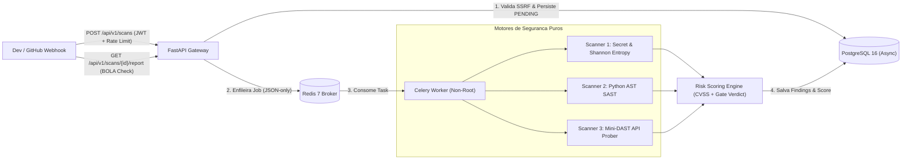

# 🛡️ SecSentinel — Plataforma DevSecOps de Auditoria de Pull Requests e APIs

[](.github/workflows/ci.yml)
[](https://www.python.org/)
[](https://fastapi.tiangolo.com/)
[](https://www.sqlalchemy.org/)
[](k8s/)

**SecSentinel** é uma plataforma assíncrona de automação de segurança (**AppSec / DevSecOps**) projetada para auditar Pull Requests e APIs REST em tempo real. Combina três motores independentes de análise (**Secret Scanning por Entropia de Shannon**, **SAST via Python AST** e **Mini-DAST API Prober**) com um motor de cálculo de risco baseado no **Princípio do Elo Mais Fraco (CVSS v3.1)** para atuar como **Quality Gate automatizado (`PASS` / `WARN` / `BLOCK`)** em esteiras de CI/CD.

---

## ⚡ Quickstart "Zero Friction" para Recrutadores (2 Comandos)

Suba toda a infraestrutura (PostgreSQL 16, Redis 7, Migrations Alembic, API FastAPI, Celery Worker e **Seed automático com Token JWT pré-gerado**) em apenas **2 comandos**:

```bash
make setup
make up
```

Ao final do `make up`, o terminal exibirá automaticamente:
- 🌐 **Swagger UI Interativo:** [`http://localhost:8000/docs`](http://localhost:8000/docs)
- 🩺 **Readiness & Deep Health Check:** [`http://localhost:8000/healthz`](http://localhost:8000/healthz)
- 👤 **Usuário de Teste Pré-Cadastrado:** `admin@secsentinel.local` / `senha123` (Role: `ADMIN`)
- 📊 **Scan Demonstrativo Pré-Populado:** `00000000-0000-0000-0000-000000000001` (Veredito: `BLOCK`, Risk Score: `10.0`)
- 🔑 **Token JWT Válido (24h):** Pronto para copiar e colar no botão **Authorize** do Swagger ou usar via [`requests.http`](requests.http) no VS Code / Cursor!

### Comandos Úteis do `Makefile`
| Comando | O que faz |
| :--- | :--- |
| `make setup` | Cria o `.env` a partir do `.env.example` e gera uma `JWT_SECRET_KEY` criptográfica de 256 bits automaticamente |
| `make up` | Constrói a imagem multi-stage non-root, sobe os containers, aguarda healthchecks, roda migrações e executa o Seed |
| `make seed` | Reexecuta o Seed idempotente e imprime novamente o painel com a URL do Swagger e um Token JWT válido |
| `make test` | Executa a suíte de testes automatizados com relatório de cobertura no terminal (`>= 85%`) |
| `make ci` | Roda localmente toda a esteira DevSecOps (`ruff check`, `Bandit`, `mypy src` e `pytest --cov`) |
| `make down` | Para e remove todos os containers e redes de forma limpa |

---

## 🏗️ Arquitetura do Sistema (Clean Architecture + Processamento Assíncrono)

O projeto segue rigorosamente a **Regra da Dependência** da Clean Architecture combinada com o padrão **Service-Repository**: os motores de segurança (`src/secsentinel/scanners/`) são pacotes de domínio puros e determinísticos, 100% desacoplados de frameworks web (FastAPI) e de ORM (SQLAlchemy).



---

## 🔬 Os 3 Motores de Segurança e o Motor de Risco

### 1. Motor de Detecção de Credenciais (`scanners/secrets/engine.py`)
- **Assinaturas Determinísticas (Regex):** Detecta AWS Access Keys (`AKIA...`), GitHub Personal/Fine-Grained Tokens (`ghp_...`, `github_pat_...`), Slack Tokens, Stripe Live Keys e blocos de chaves privadas (`RSA`/`OPENSSH`/`EC`).
- **Análise Matemática de Entropia de Shannon ($H(X)$):** Calcula a incerteza informacional em bits por caractere para identificar segredos genéricos de alta aleatoriedade que não possuem prefixo fixo:
  $$H(X) = -\sum P(x_i) \log_2 P(x_i)$$
- **Zero-Trust Redaction (`redact_secret`):** O segredo capturado é mascarado imediatamente em memória (`AKIA****MPLE`) antes de instanciar o objeto `RawFinding`, garantindo que o banco de dados e os logs jamais se tornem um repositório de credenciais vazadas.

### 2. Motor SAST via Abstract Syntax Tree (`scanners/sast/engine.py`)
- Analisa código Python convertendo-o em uma **Árvore Sintática Abstrata (`ast.parse`)** sem jamais executar o código não confiável:
  - **`SAST-RCE-001` (CWE-95):** Uso de `eval()` ou `exec()`.
  - **`SAST-CMD-001` (CWE-78):** Execução de comandos via `os.system()`, `os.popen()` ou `subprocess.*(..., shell=True)`.
  - **`SAST-SQLI-001` (CWE-89):** Construção dinâmica de queries SQL via `f-strings` (`ast.JoinedStr`), concatenação (`+`) ou `.format()` dentro de `.execute()`.
  - **`SAST-DESER-001` (CWE-502):** Deserialização arbitrária via `pickle.loads()` ou `yaml.load()` sem `SafeLoader`.
  - **`SAST-CRYPTO-001` (CWE-328):** Uso de algoritmos de hash criptograficamente quebrados (`hashlib.md5`, `hashlib.sha1`).

### 3. Motor Mini-DAST / API Prober (`scanners/dast/engine.py`)
- Audita endpoints HTTP/HTTPS em execução usando `httpx.AsyncClient` com `follow_redirects=False`:
  - **Prevenção de DNS Rebinding Anti-SSRF (`validate_target_dns_against_ssrf`):** Resolve o DNS via `socket.getaddrinfo()` antes da conexão HTTP e bloqueia qualquer domínio que resolva para IPs privados (RFC 1918), loopback (`127.0.0.1`, `::1`) ou Cloud Metadata (`169.254.169.254`).
  - **Auditoria de Security Headers:** Verifica `Strict-Transport-Security` (HSTS), `Content-Security-Policy` (CSP), `X-Content-Type-Options: nosniff` e vazamento de versões no banner `Server`.
  - **Auditoria Ativa de CORS:** Envia cabeçalho `Origin` controlado para detectar reflexão arbitrária combinada com `Access-Control-Allow-Credentials: true` (**CVSS 9.1 - CRITICAL**).
  - **Sonda de Bypass JWT `alg: none`:** Testa se endpoints protegidos (`401/403`) aceitam tokens JWT forjados sem assinatura criptográfica (**CVSS 9.8 - CRITICAL**).

### 4. Motor de Cálculo de Risco e CI/CD Gate (`services/risk_engine.py`)
- Aplica o **Princípio do Elo Mais Fraco (*Worst-Case Base + Cumulative Penalty*)**: parte do maior CVSS detectado e soma penalidades cumulativas ponderadas por severidade (teto `10.0`), evitando que falhas informativas diluam falhas críticas.
- Emite o veredito de esteira (`SecurityVerdict`): **`PASS`**, **`WARN`** ou **`BLOCK`**.

---

## 🔒 Defesa em Profundidade da Própria Plataforma (Self-Hardening)

| Camada | Ameaça Mitigada (OWASP / CWE) | Implementação no SecSentinel |
| :--- | :--- | :--- |
| **Configuração** | Fail-Open / Vazamento de Secrets em Logs | `pydantic-settings` com `SecretStr` e validação *Fail-Fast* (recusa chaves JWT < 32 bytes ou `DEBUG=True` em produção). |
| **Autenticação** | Brute-Force, GPU Cracking & JWT Forgery | Hashing **Argon2id** (`pwdlib`), JWT com claims `jti`/`type`/`role` estritos, bloqueio de `alg: none` e proteção contra *Token Type Confusion*. |
| **Autorização** | BOLA / IDOR (OWASP API1:2023) | Chaves primárias `UUIDv4` + validação de propriedade no `ScanService` (`DEVELOPER` só acessa seus próprios scans; `AUDITOR`/`ADMIN` possuem visão global). |
| **Fila & Workers** | Pickle Deserialization RCE & Container Breakout | Celery travado exclusivamente em `accept_content=["json"]` e Dockerfile multi-stage rodando sob usuário Linux sem privilégios (`UID 10001`). |
| **Rede & Entrada** | Server-Side Request Forgery (SSRF - API7:2023) | Dupla camada Anti-SSRF: validação de URL/IP no schema Pydantic + validação de resolução DNS anti-rebinding no DAST. |
| **Observabilidade** | Falsos Positivos em Load Balancers | Separação entre Liveness (`/health`) e Readiness ativa (`/healthz` e `/ready`) que testa `SELECT 1` no PostgreSQL e `PING` no Redis com medição de latência. |
| **Tratamento de Erros** | Stack Trace Disclosure (CWE-209) | `unhandled_exception_handler` global que registra o traceback apenas nos logs internos e retorna resposta HTTP 500 sanitizada. |

---

## ☸️ Orquestração Cloud-Native (Kubernetes em `/k8s`)

Embora a avaliação local seja feita com **Zero Friction via Docker Compose** (`make setup && make up`), a pasta [`/k8s`](k8s/) demonstra a arquitetura declarativa pronta para clusters de produção (EKS / GKE / AKS):

- [`k8s/configmap.yaml`](k8s/configmap.yaml): Separação 12-Factor App entre configurações de ambiente (`ConfigMap`) e credenciais (`Secret` integrado via External Secrets Operator).
- [`k8s/deployment.yaml`](k8s/deployment.yaml): Deployments da API e do Celery Worker com **Pod Security Standards (Restricted)**: `runAsNonRoot: true`, `runAsUser: 10001`, `readOnlyRootFilesystem: true`, `allowPrivilegeEscalation: false`, `capabilities.drop: ["ALL"]`, perfil `seccomp: RuntimeDefault`, `livenessProbe` (`/health`) e `readinessProbe` (`/healthz`).
- [`k8s/service.yaml`](k8s/service.yaml): Exposição interna via `ClusterIP` desacoplada dos Pods.
- [`k8s/hpa.yaml`](k8s/hpa.yaml): `HorizontalPodAutoscaler` (`autoscaling/v2`) escalando de 2 a 10 réplicas por CPU (70%) e Memória (80%) com janela de estabilização anti-flapping (`300s`).

---

## 📡 Principais Endpoints da API

| Método | Rota | Descrição | Controle de Acesso |
| :--- | :--- | :--- | :--- |
| `GET` | `/health` | **Liveness Probe** leve do processo FastAPI/ASGI | Público |
| `GET` | `/healthz` ou `/ready` | **Readiness Probe Realista** (testa ativamente PostgreSQL `SELECT 1` + Redis `PING` com latência) | Público (`200 OK` / `503 Service Unavailable`) |
| `POST` | `/api/v1/auth/register` | Registro de usuário (`DEVELOPER`) com política estrita de senha, `extra="forbid"` e hash Argon2id | Público (Rate Limited `10/minute`) |
| `POST` | `/api/v1/auth/login` | Autenticação e emissão de par `access_token` + `refresh_token` | Público (Rate Limited `5/minute`) |
| `POST` | `/api/v1/auth/refresh` | Rotação de par JWT usando um `refresh_token` válido | Público (Rate Limited `10/minute`) |
| `GET` | `/api/v1/auth/me` | Retorna os dados do usuário autenticado pelo JWT | Autenticado |
| `GET` | `/api/v1/auth/admin-audit-check` | Rota administrativa de verificação de privilégios | RBAC: `ADMIN` / `AUDITOR` |
| `PATCH` | `/api/v1/auth/users/{user_id}/role` | Promoção/alteração de papel RBAC (bloqueia auto-alteração) | RBAC: `ADMIN` |
| `POST` | `/api/v1/scans` | Enfileira uma auditoria assíncrona (`pr_audit`, `api_audit`, `full_audit`) | Autenticado (`202 Accepted`, Rate Limited `20/minute`) |
| `GET` | `/api/v1/scans/{scan_id}` | Consulta o status e achados brutos do Scan | Autenticado + Anti-BOLA |
| `GET` | `/api/v1/scans/{scan_id}/report` | Gera o **Relatório Executivo** com `risk_score` e veredito (`PASS`/`WARN`/`BLOCK`) | Autenticado + Anti-BOLA |
